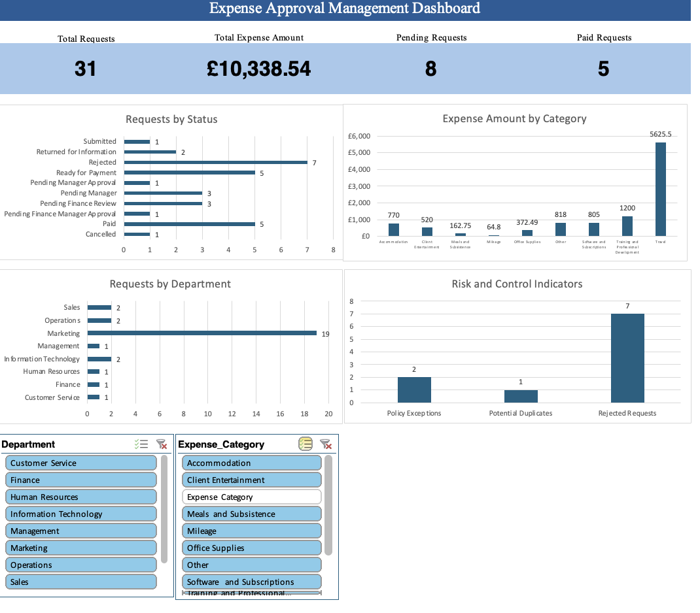

# Invoice & Expense Approval Automation

## Project Overview

This portfolio project demonstrates the analysis, design and development of an automated invoice and expense approval process.

The solution is designed to reduce manual work, improve approval visibility and provide accurate expense reporting for management.

## Business Problem

Many organisations manage employee expense claims through emails, spreadsheets and manual approval processes. This can result in incomplete information, approval delays, duplicated data entry and limited visibility of outstanding requests.

## Project Objectives

- Reduce manual processing of expense requests
- Improve the accuracy and completeness of submitted information
- Automate approval routing based on business rules
- Allow employees to track request status
- Provide management reporting through an Excel dashboard
- Maintain an audit trail of approval decisions

## Implemented Solution

1. Employees submit an expense request through Microsoft Forms.
2. Power Automate validates the submission and generates an Expense ID.
3. The request is checked for possible duplicates and routed using the approval rules.
4. Approvers approve, return or reject the request.
5. Decisions, status changes and errors are recorded in Excel tables on OneDrive for Business.
6. Eligible requests move to Ready for Payment; a separate flow records payment completion.
7. The Excel dashboard summarises requests, spending and risk indicators.

## Dashboard Preview

The Excel dashboard provides an overview of expense requests, approval status, spending patterns and potential risk indicators.

It uses PivotCharts and slicers to support interactive reporting and help stakeholders monitor the approval process.

Key features:

KPI Monitoring: Tracks total requests, expense amounts, pending approvals and paid requests.

Expense Analysis: Visualises spending by category and request volume by department.

Approval Tracking: Monitors requests across different approval stages.

Risk & Control Monitoring: Highlights policy exceptions, potential duplicate claims and rejected requests.

Interactive Filtering: Enables users to explore data by department and expense category.

  

## Tools

- Microsoft Forms
- Power Automate
- OneDrive for Business
- Excel Desktop dashboard
- SQLite
- Python
- GitHub

## Repository Structure

- `docs/` — Business analysis documentation
- `sql/` — Database schema and analysis queries
- `python/` — Data quality checker
- `README_SQL_PYTHON.md` — Instructions for SQL and Python assets

## Project Status

Completed portfolio prototype.
